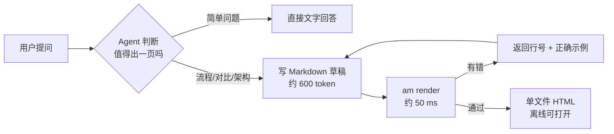
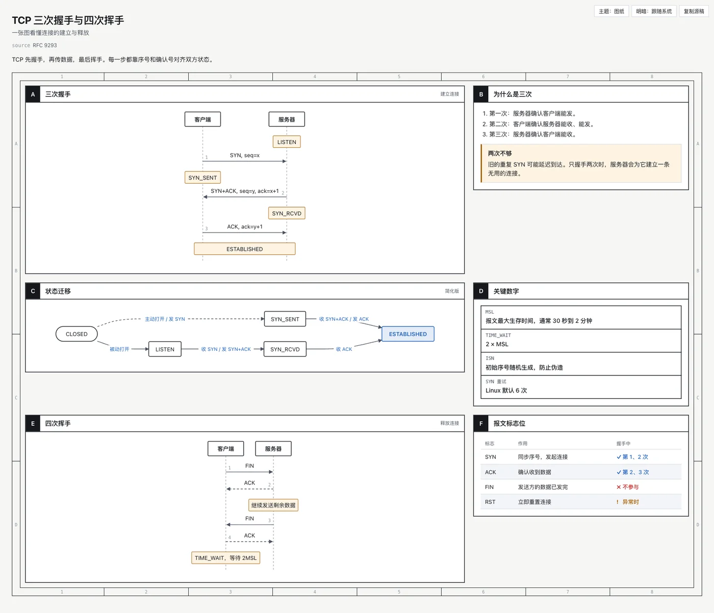
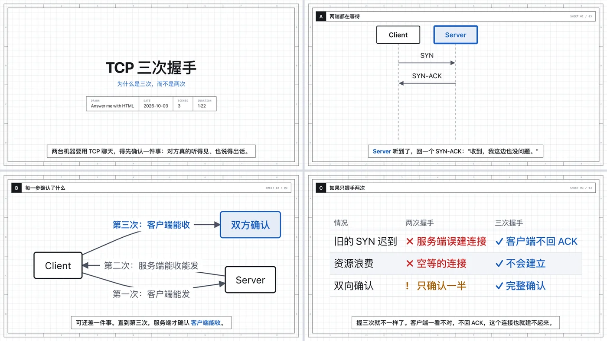

## 核心内容提炼

[answer-me-with-html](https://github.com/QingYunA/answer-me-with-html) 是一个给 AI 编程助手用的 Skill，支持 Claude Code、Codex、Cursor、OpenCode 等。装上之后照常提问，遇到流程、架构、对比这类问题，Agent 不再甩给你一堵文字墙，而是生成一页带时序图、状态图、表格的单文件 HTML。

它和"直接让模型写 HTML"的关键区别是**分工**：模型只写一份几百 token 的扩展 Markdown 草稿，排版、配色、深色模式、SVG 坐标全部交给 Skill 自带的命令行工具 `am` 用代码算出来。作者实测，模型输出的 token 减少 5~8 倍，等待时间从 30~50 秒降到 12~14 秒。

项目 2026 年 10 月 20 日首次提交，不到三周 GitHub 星数超过 6000。本文基于源码阅读、作者的测试数据，以及我在自己服务器上给 Claude Code 和 Codex 实际安装的过程。

> 由 claude-opus-5-5 模型总结提炼，观点仅供参考。

## 它要解决什么问题

Andrej Karpathy 说过：LLM 干的活越来越多，人类真正的瓶颈变成了"读懂它的输出"。图和网页显然比长文本好读。

作者一开始也是直接让 Agent 输出 HTML。页面效果不错，但太慢：一页像样的页面要一两分钟，大部分时间花在几乎每次都一样的几百行 CSS 上。画图更糟，模型要手算 SVG 坐标，箭头经常指不到节点上。

作者统计了 9 个模型手写的 HTML 页面，平均 4,893 token，构成如下：

| 页面组成 | 占比 | 用这个 Skill 后由谁来写 |
| :--- | ---: | :--- |
| SVG 图形：坐标和路径 | 47% | `am` 工具生成 |
| HTML 标签 | 17% | `am` 工具生成 |
| CSS 样式 | 15% | `am` 工具生成 |
| 文字内容 | 21% | 模型写，格式是 Markdown |

结论很直接：**模型写的近 80% 都不是内容**。把这 80% 交给确定性的代码，模型只负责那 21% 的文字和结构。

## 工作原理



模型写的草稿长这样，用围栏代码块描述图形，不碰任何坐标：

````markdown
---
title: TCP 三次握手
---
## A 三次握手 {span=2}
```sequence num
Client -> Server: SYN, seq=x
Server -> Client: SYN+ACK, seq=y, ack=x+1
Client -> Server: ACK, ack=y+1
note Client, Server: ESTABLISHED
```

## C 状态迁移 {span=2}
```flow LR
(CLOSED) -> LISTEN: 被动打开
LISTEN -> SYN_RCVD: 收 SYN / 发 SYN+ACK
SYN_RCVD -> *ESTABLISHED: 收 ACK
```
````

剩下的事都由 `am` 完成：选模板、在网格里摆放面板、套主题；流程图用 [dagre](https://github.com/dagrejs/dagre) 自动布局，时序图按文字宽度计算间距。最终输出是这样一页：

{: width="1400" height="1202" .shadow .rounded-10 }
_同一份草稿生成的页面：时序图、状态图、关键数字和标志位表格_

目前支持 12 种组件：流程图、时序图、ER 图、树、时间线、柱状图、折线图、饼图、键值表、标注、提示框，以及让用户在页面上做选择的 `ask` 组件。Agent 会按信息的形状自己挑组件。

## 实测数据

作者的测试设置：同样的 3 个题目（TCP 握手、Redis vs Memcached、git merge vs rebase），每组跑 3 次取中位数，模型是 Claude Sonnet 5.5，数据直接取自 `claude -p --output-format json`。

| 场景 | 输出 token | 耗时 | 每次费用 |
| :--- | :--- | :--- | :--- |
| 精简环境（上下文约 2.5 万 token） | 4,932 → **1,007**（4.9×） | 31 s → **12 s** | $0.091 → $0.077（省 15%） |
| 插件多的环境（上下文约 8.6 万 token） | 7,656 → **1,070**（7.2×） | 50 s → **14 s** | $0.220 → $0.138（省 37%） |

有两点值得注意：

- **速度提升是实打实的**，所有配置下都成立。
- **省钱没有省 token 那么多**。每轮对话都要读系统提示、问题和上下文，这部分费用用不用 Skill 都一样。作者也坦白，更早的一次测试里，插件多的环境下用了 Skill 反而贵了约 20%，原因是提示缓存没命中。

另外，两种方式生成的页面风格也不同：直接写 HTML 得到的是一篇更长的文章，用 Skill 得到的是一两屏的紧凑页面。

## 值得借鉴的设计

### 1. 让模型一次改对

草稿有错时，`am` 不会只抛一句"解析失败"，而是返回**行号、出错的组件和一个正确示例**。如果草稿是从标准输入传进来的，工具还会把它存成文件，让 Agent 只改出错的那几行，不用整份重写。这个设计对所有"LLM + 工具"的系统都适用：错误信息写得越具体，模型越可能一次改对。

### 2. 引用真实代码，而不是让模型重敲

代码块可以写 `src=` 和 `lines=`，直接从项目文件里截取，页面上的代码就是仓库里的真代码。安全上也做了防护：

- 拒绝读取项目目录外的文件。
- 拒绝 `.env`、私钥、`credentials.*`、`.pem`、`.tfstate` 等约定俗成存放机密的文件。
- 文件内容里只要出现疑似密钥（`sk-ant-`、`AKIA…`、`ghp_…`、带密码的 URL 等），整个文件都不引用。

### 3. 页面能把反馈带回给 Agent

用户可以在任意面板上写评论，回答 Agent 用 `ask` 组件提的选择题，再点 Reply 按钮，把所有回答汇总成一条消息，粘贴回对话框。页面不再是终点，而是对话的一部分。

### 4. 每页都带着源稿

每个页面都嵌入了生成它的 Markdown，点"复制源稿"就能拿回来改。另外，页面是不依赖 CDN 和网络字体的单文件 HTML，离线能打开，适合存档和转发。

### 5. 写作规范检查

草稿会按改编自 ASD-STE100 的规则检查：句子太长、措辞啰嗦、被动语态。ASD-STE100 是航空业的技术文档写作标准。默认只警告，开启严格模式才会拦截。

### 6. 讲解视频

除了网页，还能生成 3Blue1Brown 风格的讲解视频。草稿里每一段多写一行旁白，`am video` 就会生成一个播放页：图形跟着旁白一步步出现，镜头会跟随旁白里用方括号标出的节点；配音直接嵌在页面里，离线也能播放；还能在浏览器里直接导出视频文件，不需要 ffmpeg。

{: width="1400" height="789" .shadow .rounded-10 }
_讲解视频的几个画面：标题、时序图、流程图、对比表_

## 工程质量

我把仓库克隆下来读了源码：

| 维度 | 情况 |
| :--- | :--- |
| 代码量 | 约 1.4 万行 JavaScript |
| 测试 | 88 个测试文件，CI 要求行覆盖率 ≥ 85%、分支覆盖率 ≥ 80% |
| 运行时依赖 | 只有 4 个：dagre、marked、temml、一个字体包 |
| 分发方式 | 用 esbuild 打包成单个约 1 MB 的 `am.mjs`，放在 Skill 目录里，安装后不用 `npm install` |
| 联网行为 | 每天最多检查一次 GitHub 上的版本号；配置了 ElevenLabs 密钥时才调用它的配音接口。没有看到上传用户数据 |
| 本地服务 | 可选的 `am serve` 默认只监听 127.0.0.1，每个页面链接带 HMAC 令牌 |

对于一个三周大的项目，这个工程完成度相当高。

## 同类项目对比

下表的星数是 2026-11-08 通过 GitHub API 查询的：

| 项目 | ★ | 定位 |
| :--- | ---: | :--- |
| [tt-a1i/archify](https://github.com/tt-a1i/archify) | 94.5k | 专做**单张交互式架构图**，模型写 JSON 描述。能缩放、追踪路径、演示，还能导出 PNG、SVG、视频。画图能力最强，但不做"整页回答" |
| [nicobailon/visual-explainer](https://github.com/nicobailon/visual-explainer) | 10.9k | 生成 HTML 页面或幻灯片，覆盖画图、审 diff、审计划、项目回顾等场景，用 Mermaid 画图 |
| [QingYunA/answer-me-with-html](https://github.com/QingYunA/answer-me-with-html) | 6.0k | **整个回答排成一页**，模型只写 Markdown，输出 token 最省 |
| [omdsh-dev/dsh-genui](https://github.com/omdsh-dev/dsh-genui) | 888 | 在 DeepSeek Harness 的网页聊天里直接显示交互组件，终端里用不了 |

怎么选：

- 日常在终端里提问，想把回答看得更明白，选 answer-me-with-html。
- 要画系统架构图并拿去演示，选 Archify。
- 代码评审、计划审查这类开发场景，选 visual-explainer。

## 安装实践

### Claude Code

```bash
claude plugin marketplace add QingYunA/answer-me-with-html
claude plugin install answer-me-with-html@answer-me-with-html
```

在 Claude Code 里输入 `/plugin` 也可以完成同样的操作。装好后要**新开一个会话**才会生效。

### Codex 等其他 Agent

```bash
npx -y skills add QingYunA/answer-me-with-html -g -y -a codex
```

也可以手动把仓库里的 `skills/answer-me-with-html` 目录复制到 `~/.codex/skills/`。我用的是手动复制，直接复用了 Claude Code 插件里的同一份文件。

### 我踩到的坑

1. **Node.js 版本**。Skill 要求 Node 20 以上，我的服务器系统自带的是 v18，第一次调用就会报错。服务器上还有别的程序在用 Node 18，所以我没有升级系统 Node，而是用 nvm 装了 v22，只在 `~/.zshrc` 里把它放到 PATH 最前面。cron 定时任务都有自己写死的 PATH，不受影响。
2. **服务器上没有浏览器**。默认生成页面后会自动打开浏览器，服务器上应该关掉：

   ```bash
   node <skill目录>/scripts/am.mjs config set open off
   ```

   生成的页面存在 `~/.answer-me-with-html/pages/`，用 scp 拿到本地打开即可。
3. **Codex 的手动安装不会自动更新**。升级 Claude Code 插件后，要再复制一次到 Codex 的目录。

## 使用建议

- **默认就会频繁触发**。Skill 的描述里写着"主动、大量使用，拿不准时就用"。`SKILL.md` 有 26 KB，每次触发都要读进上下文。如果你只想在需要时用，可以在提问时明确说"画个图"或"用 HTML 讲"。
- **谨慎开启"常开模式"**。作者推荐开启，开了之后每个结论都会附带一页。页面会快速堆积，要定期用 `am clean` 清理，token 消耗也会增加。
- **安装方式的信任问题**。README 推荐让 Agent 去读远程的 `INSTALL.md` 并照着执行，这等于信任作者仓库当时的内容。更稳妥的做法是自己执行上面的安装命令，或者把每一步写进提示词。另外要知道，实际运行的是发布时打包好的 `am.mjs`，你在仓库里审查的源码和它不是同一个文件。

总的来说，这个项目最有价值的不是"生成好看的网页"，而是它示范了一种分工：**让 LLM 只做需要语言能力的部分，凡是能用代码确定性完成的，都交给代码**。这个思路可以推广到很多 Agent 工具的设计上。

## 原文链接

- 项目仓库：<https://github.com/QingYunA/answer-me-with-html>
- 测试数据：<https://github.com/QingYunA/answer-me-with-html/blob/main/bench/README.md>
- 同类项目对比：<https://github.com/QingYunA/answer-me-with-html/blob/main/docs/compare.md>
