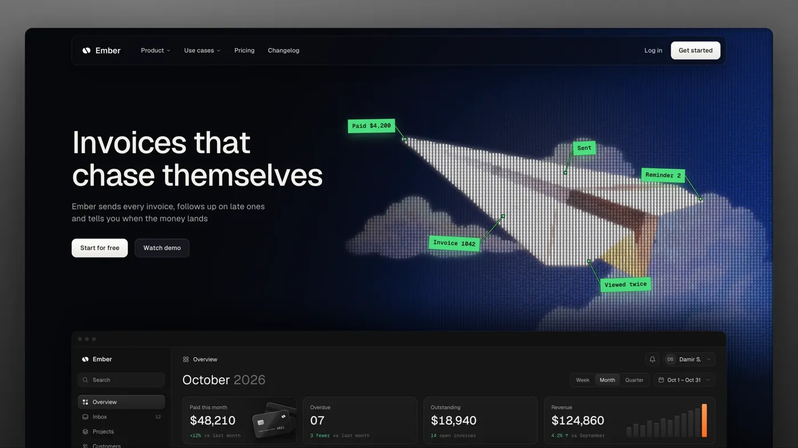
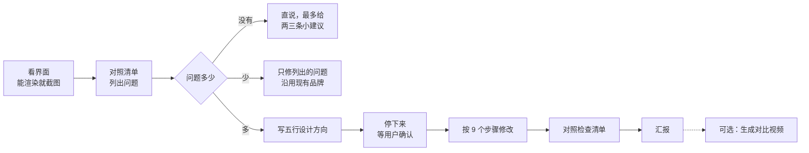
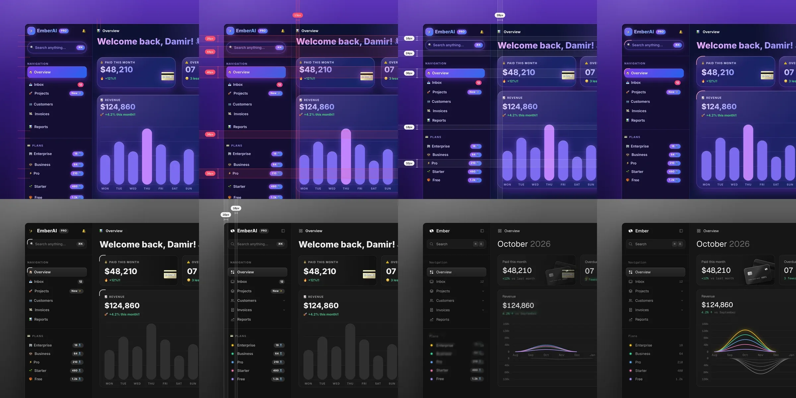

## 核心内容提炼

[unslop](https://github.com/heydamir/unslop) 是一个给 AI 编程助手用的 Skill，支持 Claude Code、Codex 和 Google Antigravity。它专门处理"一眼就是 AI 做的"界面：紫蓝渐变、到处发光、emoji 当图标、`Welcome back! 👋` 式的标题。它会先列出这些问题，再根据产品本身定一个设计方向，最后像设计师批改稿子一样，按固定顺序逐层修改。

项目 2026 年 10 月 29 日创建，11 天里 GitHub 星数超过 1.2 万，Fork 679 个。仓库里几乎没有程序代码，主体是一份 235 行的规则文档和几份参考资料，另外有两个 Playwright 脚本，分别用来抓取网页和生成对比视频。

本文基于我对源码的完整阅读，以及在服务器上对仓库自带示例的截图。我没有在真实项目上跑过完整流程。

> 由 claude-opus-5-5 模型总结提炼，观点仅供参考。

## 它要解决什么问题

让 AI 写前端已经很普遍，但生成的界面长得都差不多：紫色到蓝色的渐变背景，卡片发光，导航每一项前面都有 emoji，标签全大写加宽字距，标题写着"Supercharge your workflow"，数字后面跟两个感叹号。英文圈管这种东西叫 slop，大意是"AI 批量产出的糊弄货"。

作者 Damir Sokolovsky 是一名独立 UI 设计师。他在 X 上做了一个"Unslopping"系列，其中一条视频让一个 AI 风格的仪表盘一步步变成像样的设计，传播很广。之后他把自己的方法写成 Skill 开源了，就是这个项目。

下面是仓库自带的示例页面，我用 Chromium 截的图。示例是故意做成 AI 风格的，把常见毛病几乎都集齐了：

{: width="1400" height="875" .shadow .rounded-10 }
_examples/hero.html：渐变标题、✨ 徽章、无来源的"10,000+ teams"、发光的 3D 团块_

这是作者用同一套方法改出来的结果：

{: width="1400" height="788" .shadow .rounded-10 }
_改造后：标题直接说产品做什么，纸飞机由数字和货币符号组成，下方露出产品界面（图片来自 unslop 仓库，作者 [@heydamir](https://x.com/heydamir)，CC BY 4.0）_

## 核心观点：丰富感放在哪里

整个 Skill 建立在一句话上：

> AI 味是把颜色和特效撒在整个界面上，背景、按钮、边框、标签都在抢眼；设计感是让界面框架保持安静，把丰富的部分集中在一两个内容上。

所以它不是简单地"删掉花哨的东西"。删完之后，每个页面还得有一个精心做的重点，比如一个有质感的实物渲染、一张画得很好的图表、一幅来自产品所属场景的插图。上面落地页里的纸飞机就是这样的重点。

它也明确指出了另一种失败：删干净之后，变成纯灰背景加 Inter 字体加一个主色按钮的"模板脸"。它的检查办法是：**把产品名换成别家的，这个页面是不是照样能用？能用就说明改得还不够。**

## 工作流程



### 1. 列出问题

参考文件 `signs.md` 收了大约 60 种 AI 痕迹，分成颜色、字体、图标、间距、文案、组件、落地页、配图、动效几类，每条都写好了对应的改法。几个例子：

| AI 痕迹 | 改法 |
| :--- | :--- |
| `shadow-[0_0_20px_rgba(139,92,246,0.5)]` 这类彩色发光 | 删掉，层次靠背景色阶和细边框 |
| `NAVIGATION`、`PAID THIS MONTH` 这类全大写宽字距标签 | 改成句首大写，正常字距 |
| `$48,210` 旁边是 `$124,860.40` | 统一格式，用等宽数字 |
| `+12%!!` | `+12% vs last month`，说清和什么比 |
| `mt-[13px]`、`h-[31px]` 这类随手写的值 | 换成 4px 网格上的值 |
| 每张统计卡都塞一个迷你折线图 | 只留标签、数字和变化 |
| `animate-pulse` 用在不是实时状态的东西上 | 改成静态 |

### 2. 判断要改多少

这一步很少有工具会做。它把结果分成三档：问题多就完整重做；问题少就只修清单上的问题，配色、字体、布局都不动；完全没问题就直说，最多给两三条带具体数值的建议，用户同意才改。规则里原话是：**不要为了不同而改一个好的界面。**

### 3. 写设计方向，然后停下来

动手之前先写五行：

- **产品**：做什么、给谁用，一句话。
- **性格**：两三个具体的词，比如"冷静、精确、带一点温度"。禁止用 clean、modern、sleek、minimal、premium，因为任何模板都能这么形容。
- **场景**：产品天然属于什么地方或材质。笔记应用靠近纸和墨，监控工具靠近仪表和夜班，旅行应用靠近地图和窗外的光。这一条决定中性色往哪个方向偏、主色是什么、配图画什么。
- **重点**：页面上哪一两个位置可以用丰富的颜色和细节。
- **签名细节**：一个只属于这个产品的小细节，全页面一致使用。比如监控工具的实时状态点、开发者工具的键帽样式。只要一个。

写完后**必须停下来等用户确认**，除非用户一开始就说"直接做"。理由很实际：方向错了，后面全部要重来。

### 4. 按 9 个步骤修改

顺序是固定的，每一步都做完整个页面再进入下一步：

| 顺序 | 步骤 | 为什么排在这里 |
| ---: | :--- | :--- |
| 1 | 间距 | 节奏对了，其他东西看起来都不一样 |
| 2 | 颜色 | 一套中性色阶，三种文字颜色，一个主色 |
| 3 | 图标 | emoji 全部换成同一套线性图标 |
| 4 | 文案 | 标题长短决定了字号和位置，所以排在字体前面 |
| 5 | 字体 | 只用 400/500 两种字重，层级靠字号和颜色 |
| 6 | 布局 | 保留原有区块和顺序，只调对齐和比例 |
| 7 | 细节 | 嵌套圆角、图表、统计卡、激活状态 |
| 8 | 配图 | 放到最后，要配合一个不靠配图也成立的页面 |
| 9 | 动效 | 同上 |

每一步都有具体数值。参考文件 `tokens.md` 给了间距刻度（4、8、12、16…128）、三套深浅色中性色板（石墨灰、暖灰、墨蓝）、侧边栏宽度 240–280、导航行高 32–36、主图表至少占内容宽度三分之二等。

下面是仓库自带的仪表盘示例，以及作者的改造结果：

{: width="2400" height="1200" .shadow .rounded-10 }
_作者那条视频的 8 帧，从左上到右下：红色标注量出间距问题，紫色褪掉，emoji 换成图标，柱状图变成曲线（图片来自 unslop 仓库，CC BY 4.0）_

### 5. 配图

落地页通常需要一张配图。如果接入了生图服务（fal、Replicate、OpenAI images 等），它会先把画面写成一句话，比如"保护备份的工具 → 雾中礁石上的一座小灯塔，光束照进雾里"，然后把提示词给用户看，确认后再生成，因为要花钱。没有生图工具时，就用代码搭一个产品界面预览，并把提示词留给用户。

它禁止的配图也很明确：光滑的 3D 团块、星云、漂浮立方体、霓虹电路、发光的大脑、机器人、火箭。

## 两个脚本

### snapshot.mjs：只有网址时用

用 Playwright 打开网页，先一屏一屏滚到底，让懒加载的内容都加载出来；然后把 CSS 和图片全部内联，存成一个不依赖网络的 HTML 文件，同时截一张原页面的图，方便对比。代价是会去掉所有脚本，单页应用的交互和脚本画的动画背景都会丢失，文档里也说明了这一点。

### story.mjs：生成对比视频

那条视频的做法值得一看。它没有拼接前后两张截图，而是让一个页面"自己变形"：

- **只改 CSS**：每一步的修改写在 `.s1`、`.s2` 这样的类下面，依次叠加到 `<html>` 上，浏览器的 transition 让间距、颜色、圆角从旧值平滑过渡到新值。
- **波浪效果**：每个元素按它在页面上的位置，延迟 0 到 420 毫秒开始动，变化像从左上角扩散到右下角。
- **文字逐字滚入**：要换掉的文字先模糊消失，新文字一个字母一个字母升起。
- **红色标注**：间距的测量线会跟着元素实时变化，数字从旧值数到新值，修好后由红变白。
- **合成**：脚本控制时间轴逐帧截图，再用 ffmpeg 合成 10 秒左右的方形 MP4。

渐变这类不能平滑过渡的属性，它也给了办法：把渐变放到单独一层，让这一层的透明度降到 0。胶囊形按钮的圆角要写成高度的一半（比如 `23px`），不要写 `9999px`，否则圆角只会在最后一帧突变。

## 值得借鉴的设计

1. **先有一个明确观点，再写规则**。"丰富感集中在一两处"这句话能推出大部分具体规则，所以规则之间不打架，模型遇到没写到的情况也有依据。
2. **防止换汤不换药**。它明确禁止用毛玻璃、颗粒质感、霓虹、bento 网格替换删掉的装饰，还专门列了"清理之后容易变成的模板脸"。
3. **规则都能执行**。每条都是一个数值、一个能直接替换的写法，或者一个能判断对错的标准，没有"要有品味"这种说法。
4. **关键节点交给人决定**。方向确认、无法核实的宣传语（比如"Loved by 10,000+ teams"）是否保留、生图花不花钱，都先问用户。
5. **控制运行成本**。一次运行最多渲染三次来检查效果；生图在后台跑的同时，前几步照常进行。
6. **主文件短，细节按需读取**。`SKILL.md` 只放流程和每步要点，问题清单、数值、配图方法、参考图都放在单独的文件里，用到哪一步才读哪个。

## 局限

- **审美很个人化**。字重只用 400/500，不用斜体，不用全大写，短文本末尾不加句号，仪表盘统一用接近纯灰的背景。这些都是作者的偏好，和已有的设计规范可能冲突。文档说"已有好的设计系统就沿用"，但具体执行时模型很可能还是按规则来。
- **文案规则只针对英文**。感叹号、句首大写、hype 词表（supercharge、seamless、unlock）在中文界面里大部分用不上，中文常见的 AI 腔调它没有覆盖。
- **没有自动检查**。哪里有问题全靠模型对照清单判断，效果取决于模型能力，同一个页面跑两次结果可能不同。像"间距是否都在 4px 网格上"这种本可以用脚本检查的项，也交给了模型。
- **视频门槛不低**。要手写每一步的 CSS 和各种标注属性，还要装 Playwright 和 ffmpeg。
- **许可证比较特殊**。用的是 CC BY 4.0 而不是常见的代码许可证，要求所有副本和改编保留署名，生成的视频里也要带 `unslop by @heydamir` 水印。
- **项目很新**。主要是作者一个人在维护，加上零星的外部 PR，测试只覆盖了两个脚本。README 末尾是作者的付费服务（3 天重做一个关键页面），开源和引流是一起做的，能持续维护多久还要观察。

## 同名项目

"unslop"已经成了一类项目的统称。下表是 2026-11-09 通过 GitHub API 查询的星数：

| 项目 | ★ | 方向 |
| :--- | ---: | :--- |
| [heydamir/unslop](https://github.com/heydamir/unslop) | 12.1k | 界面去 AI 味，本文主角 |
| [theclaymethod/unslop](https://github.com/theclaymethod/unslop) | 1.0k | 文章去 AI 味 |
| [mshumer/unslop](https://github.com/mshumer/unslop) | 563 | Python 项目，无描述，我没有看代码 |
| [MohamedAbdallah-14/unslop](https://github.com/MohamedAbdallah-14/unslop) | 184 | 文字去 AI 味：奉承、套话、成堆的破折号，可接入多种编程助手 |

## 安装

Claude Code：

```bash
git clone https://github.com/heydamir/unslop
mkdir -p ~/.claude/skills && cp -r unslop/skills/unslop ~/.claude/skills/
```

Codex 可以在对话里直接安装：

```
$skill-installer install https://github.com/heydamir/unslop/tree/main/skills/unslop
```

也可以手动复制到 `~/.agents/skills/`。Google Antigravity 复制到 `~/.gemini/antigravity/skills/`。

需要抓网页或生成视频时，在项目目录里装 Playwright，视频还需要 ffmpeg：

```bash
npm install -D playwright
npx playwright install chromium
```

使用时在 Claude Code 里输入 `/unslop 这个仪表盘`，在 Codex 里输入 `$unslop`，或者直接用自然语言描述，Agent 会自己调用。

总的来说，unslop 的价值不在于它定下了哪种审美，而在于它示范了**怎么把一位设计师的判断写成 Agent 能执行的规则**：先有一个观点，再拆成可检查的条目，给出具体数值，按依赖关系排好顺序，在关键节点停下来问人。想把自己领域的经验做成 Skill，可以参考这个结构。

## 原文链接

- 项目仓库：<https://github.com/heydamir/unslop>
- Skill 主文件：<https://github.com/heydamir/unslop/blob/main/skills/unslop/SKILL.md>
- AI 痕迹清单：<https://github.com/heydamir/unslop/blob/main/skills/unslop/references/signs.md>
- 作者的 Unslopping 系列：<https://x.com/heydamir/status/2115063463063998736>
